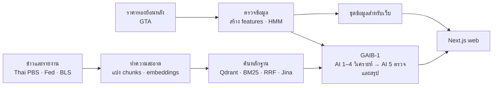

# Gold Assistant

**Gold Assistant** เป็นโปรเจกต์วิจัยและเว็บต้นแบบสำหรับสำรวจราคาทองคำไทย ใช้ข้อมูลตลาดย้อนหลัง ข่าวและรายงานเศรษฐกิจ เพื่อทดลองวิเคราะห์ภาวะตลาด ค้นหลักฐาน และจำลองพอร์ตลงทุน

> **สถานะ:** เว็บใช้ข้อมูลย้อนหลังและพอร์ตจำลอง ไม่ใช่ราคาสดหรือบัญชีลูกค้าจริง ผลจากโมเดลมีไว้เพื่อการศึกษา ไม่ใช่คำแนะนำการลงทุน
>
> **เว็บไซต์ที่ Deploy แล้ว:** [https://gold-assisstant.vercel.app/](https://gold-assisstant.vercel.app/)

## โปรเจกต์นี้ทำอะไร

- **สำรวจตลาด:** รวมข้อมูลราคาทองไทย ทองโลก และอัตราแลกเปลี่ยน พร้อมตรวจคุณภาพข้อมูลและสร้างตัวชี้วัด
- **ทดลองวิเคราะห์ภาวะตลาด:** ใช้ Gaussian HMM แบ่งภาวะจากรูปแบบข้อมูลทางสถิติ ไม่ได้ทำนายราคาหรือให้สัญญาณซื้อขาย
- **ค้นหลักฐานประกอบคำตอบ:** ทดลองค้นข่าวและรายงานด้วย hybrid retrieval แล้วแสดงแหล่งอ้างอิง
- **ดูผลผ่านเว็บ:** สำรวจข้อมูลตลาดย้อนหลัง พอร์ตจำลอง และ Gold Assistant ที่ใช้ GAIB-1 Python pipeline กับ agent 5 บทบาท

## ภาพรวมการทำงาน



สำหรับรายละเอียดขั้นตอนและการทดลอง โปรดดู [รายงานวิจัยและวิธีการ](docs/research-methodology.md).

## ข้อมูลและผลทดลองโดยสรุป

| ส่วน | ข้อมูลหรือผลที่บันทึกไว้ |
|---|---|
| ราคาทองไทย | 6,261 แถวรายวัน ตั้งแต่ 1 พ.ค. 2006 ถึง 13 ต.ค. 2026 |
| เอกสารสำหรับค้นหลักฐาน | 5,058 เอกสาร แบ่งเป็น 19,784 chunks |
| Retrieval | บนชุดคำถาม 114 ข้อ Hybrid RRF + Jina ได้ evidence recall@10 52.6% เทียบกับ 35.5% ของ Hybrid RRF |
| พอร์ตจำลอง | 1,050 พอร์ตสังเคราะห์; ตรวจบัญชีของ run `R_FEATURE_V1` แล้วไม่พบ reconciliation failures |
| GAIB-1 evaluation | ผล development ที่บันทึกไว้ 21/21 queries ไม่มี pipeline errors; ยังต้อง human review ก่อนถือเป็นการรับรอง release |

`Evidence recall@10` คือสัดส่วนหลักฐานที่ระบบค้นพบได้ในผลลัพธ์ 10 รายการแรก ตามชุดคำถามทดสอบ ตัวเลข retrieval และ multi-agent มาจากการทดลองคนละชุด ไม่ควรนำมาเปรียบเทียบหรือรวมเป็นคะแนนเดียว ผล benchmark ไม่ใช่การรับประกันความถูกต้องของคำตอบสด ดูขั้นตอนและข้อจำกัดใน [รายงานฉบับเต็ม](docs/research-methodology.md#วิธีอ่านผลและข้อจำกัด).

## ลองเปิดเว็บในเครื่อง

ต้องใช้ Node.js 20.9 ขึ้นไป เปิด PowerShell ที่ root ของ repository แล้วรัน:

```powershell
cd web
npm ci
npm run dev
```

เปิด `http://localhost:3000` เพื่อดูเว็บและข้อมูลชุดที่เตรียมไว้ การถาม Gold Assistant ต้องตั้งค่า Python runtime และ credentials ของบริการภายนอกเพิ่ม; หากยังไม่ได้ตั้ง ระบบจะแจ้งข้อผิดพลาดแทนการสร้างคำตอบสำรอง ดู [คู่มือเว็บ](web/README.md).

## Deploy เว็บและ AI backend

ใช้ **Vercel Services** deploy Next.js frontend และ Python/FastAPI runtime ใน deployment เดียว โดย frontend เรียก backend ผ่าน private service binding; GAIB-1 runtime import Python modules ที่เตรียมไว้ ไม่โหลดหรือ execute notebook ใน production. สามารถใช้ Render เป็นทางเลือกสำหรับ Python backend ได้ด้วย [`render.yaml`](render.yaml). ดู [คู่มือ Vercel Services](web/docs/vercel-deployment.md) และ [คู่มือ Render](web/docs/render-deployment.md).

## แผนที่ repository

| โฟลเดอร์ / ไฟล์ | ใช้ทำอะไร |
|---|---|
| [`web/`](web/) | เว็บ Next.js, API, ภาพประกอบ และข้อมูล snapshot ที่ deploy |
| [`dataset/`](dataset/) | ข้อมูลต้นทาง ข้อมูลที่ผ่านการเตรียม และผลจำลองพอร์ต |
| [`embedding/`](embedding/) | การแบ่งข้อความ การสร้าง embeddings และผลประเมิน retrieval |
| [`vector_database/`](vector_database/) | Notebook และ artifacts สำหรับ Qdrant |
| [`rag/`](rag/) | การทดลอง retrieval, RAG และ prompt |
| [`multi_agent/GAIB-1/`](multi_agent/GAIB-1/) | Notebook ต้นฉบับสำหรับงานวิจัยและประเมิน agent; ไม่ถูก execute ใน runtime |
| [`web/python/`](web/python/) | Python modules สำหรับ GAIB-1 serving pipeline และ FastAPI runtime |
| [`model/`](model/) | ไฟล์โมเดล HMM และข้อมูลประกอบ |
| [`artifacts/`](artifacts/) | ผลทดลองและ artifacts สำหรับ benchmark |
| [`function/`](function/) | Notebook ทดลองดึงและเตรียมข้อมูล |
| [`md/`](md/) และ [`docs/`](docs/) | เอกสารประกอบและแผนภาพ |
| [`render.yaml`](render.yaml) | การตั้งค่า Render Blueprint สำหรับ Python backend |

## ข้อควรรู้ก่อนนำผลไปใช้

- ราคาตลาดเป็นข้อมูลย้อนหลัง และข้อมูลที่ขาดหายยังคงเป็น `null`; ไม่มี feed ราคาสด
- พอร์ต ธุรกรรม และผลกำไรขาดทุนจาก simulator เป็น **ข้อมูลสังเคราะห์** ไม่ใช่ข้อมูลลูกค้า
- ข่าวที่เกิดใกล้กับการเปลี่ยนแปลงราคาไม่ได้พิสูจน์ว่าเป็นสาเหตุ
- ผล HMM เป็นการแบ่ง regime เชิงสถิติ ไม่ใช่คำทำนายหรือสัญญาณลงทุน
- GAIB-1 ใช้ corpus และบริการภายนอกสำหรับ retrieval แต่ยังไม่ได้รับ portfolio ID ที่เลือกในหน้าตาราง จึงไม่ใช่การวิเคราะห์บัญชีส่วนบุคคล
- ผล benchmark ที่ผ่านเกณฑ์ development ยังไม่ใช่ release approval; การตรวจทานโดยมนุษย์ยังจำเป็น

## เอกสารเพิ่มเติม

- [รายงานวิจัย: ที่มาข้อมูล, EDA, HMM, embeddings, RAG และตัวเลขผลทดลอง](docs/research-methodology.md)
- [แผนภาพ pipeline](docs/pipeline-diagrams.html)
- [คู่มือเริ่มเว็บและ API](web/README.md)
- [คู่มือ Deploy frontend บน Vercel](web/docs/vercel-deployment.md)
- [คู่มือ Deploy backend บน Render](web/docs/render-deployment.md)
- [ที่มาและขั้นตอนเตรียมข้อมูล](md/dataset.md)
- [EDA และ HMM](md/eda.md)
- [ข้อกำหนดและข้อจำกัดของ simulator](dataset/thai-gold-portfolio-simulator/README.md)
