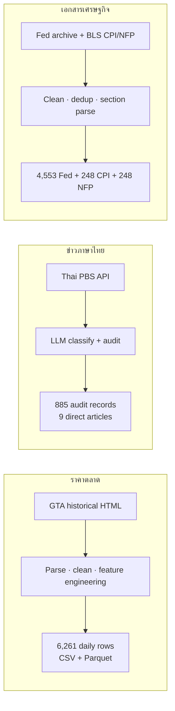
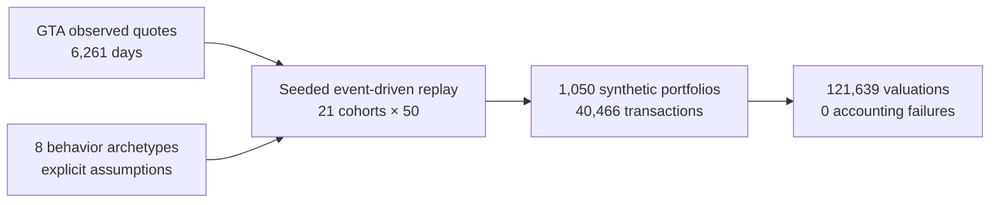
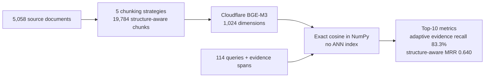
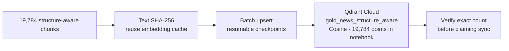
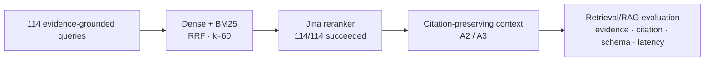
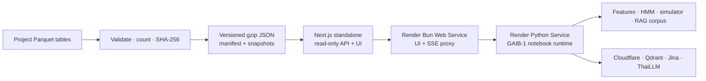

# Gold Assistant

เอกสารนี้รวบรวมรายละเอียดเชิงเทคนิคและตัวเลขจากการทดลอง สำหรับภาพรวมที่อ่านสั้นกว่าและวิธีเริ่มใช้เว็บ ให้กลับไปที่ [หน้าแรกของ repository](../README.md).

Gold Assistant เป็นโปรเจกต์ทดลองวิเคราะห์ราคาทองคำไทยด้วยข้อมูลตลาด ข่าว/เหตุการณ์ การค้นคืนหลักฐาน และการจำลองพอร์ต โดยแยกให้ชัดว่าอะไรคือ **ข้อมูลที่สังเกตได้จริง** และอะไรคือ **ผลจำลองตามสมมติฐาน** ตัวเลขจากพอร์ตจำลองไม่ใช่ประวัติการซื้อขายของลูกค้าหรือตัวแทนของนักลงทุนไทย

> **สถานะข้อมูลที่เว็บใช้:** market features และ simulator run `R_FEATURE_V1` (สร้างจากข้อมูลถึง 13 ต.ค. 2026) เว็บส่งข้อมูลที่ export ไว้เป็น gzip JSON แบบอ่านอย่างเดียว ส่วน Gold Assistant เรียก Python service บน Render ซึ่งรัน pipeline จาก notebook GAIB-1 และใช้ Qdrant Cloud, Cloudflare, Jina และ ThaiLLM. ไม่มี Supabase, application database หรือ persistent disk; Qdrant เป็น vector database ภายนอกที่จำเป็นต่อ RAG. Assistant ไม่ได้รับ portfolio ID ที่เลือกในหน้าตารางและไม่ใช้ราคาหรือข่าวสด ดู [แนวทาง deploy เว็บ](../web/docs/render-deployment.md)

## สารบัญ

- [ชุดข้อมูลและที่มา](#ชุดข้อมูลและที่มา)
- [แผนภาพ Pipeline](#แผนภาพ-pipeline)
- [สถาปัตยกรรม GAIB-1 และผลประเมินล่าสุด](#สถาปัตยกรรม-gaib-1-และผลประเมินล่าสุด)
- [หลักการทดลองและผลเชิงตัวเลข](#หลักการทดลองและผลเชิงตัวเลข)
- [วิธีอ่านผลและข้อจำกัด](#วิธีอ่านผลและข้อจำกัด)
- [เริ่มเว็บและ Deploy บน Render](#เริ่มเว็บและ-deploy-บน-render)
- [เอกสารและ Notebook ที่เกี่ยวข้อง](#เอกสารและ-notebook-ที่เกี่ยวข้อง)

## ชุดข้อมูลและที่มา

| ชุดข้อมูล | ที่มาและวิธีได้มา | ปริมาณ / ช่วงเวลา | ใช้ทำอะไรและข้อควรทราบ |
|---|---|---|---|
| **A — ราคาทองไทย** | ตารางราคาย้อนหลังจาก [สมาคมค้าทองคำ (GTA)](https://gtadmin.goldtraders.or.th/updatepricelist/) ถูกเก็บเป็น HTML แล้ว parse และทำความสะอาดด้วย Notebook; สร้าง feature CSV/Parquet สำหรับการวิเคราะห์ | ไฟล์ feature ที่ใช้งานปัจจุบันมี **6,261 แถวรายวัน**, 1 พ.ค. 2006–13 ต.ค. 2026; มี `bar_buy`, `bar_sell`, ราคา ornament, Spot, THB/USD, return, volatility, correlation และตัวชี้วัดคุณภาพ | เป็นข้อมูลราคาที่สังเกตจากประกาศตลาด ไม่ใช่บันทึกธุรกรรมของผู้ลงทุน มีค่า Spot ว่าง 540 แถวและ FX ว่าง 691 แถว; เก็บเป็น null และ **ไม่เติมค่า** |
| **B1 — ข่าวทอง Thai PBS** | เก็บรายการข่าวผ่าน [Thai PBS API](https://api.thaipbs.net) แล้วจำแนก/ตรวจ audit ความเกี่ยวข้องกับทองคำด้วย LLM ภาษาไทย | ไฟล์ classified มี **7,874 records**; audit v2 มี **885 records**: not relevant 844, direct 9, uncertain 12, indirect 20 | ใช้เอกสาร direct **9 เรื่อง** ใน corpus ปัจจุบัน; ข่าวผ่านการจำแนกไม่ได้แปลว่าข้อความนั้นพิสูจน์สาเหตุที่ทำให้ราคาขยับ |
| **B2 — Federal Reserve** | เก็บ press release จาก archive ของ [Federal Reserve Board](https://www.federalreserve.gov/newsevents/pressreleases.htm), แก้ encoding/ทำความสะอาด, กำจัดรายการซ้ำ แล้วจำแนกความเกี่ยวข้อง | **4,553 เอกสาร**, 3 ม.ค. 2006–16 ต.ค. 2026: relevant 536, uncertain 717, not relevant 3,300 | ใช้เป็นหลักฐานนโยบาย/เศรษฐกิจมหภาค; label เป็นผลจำแนก ไม่ใช่ causal label |
| **B3 — BLS Employment Situation / NFP** | เก็บรายงานย้อนหลังจาก archive ของ [U.S. Bureau of Labor Statistics](https://www.bls.gov/bls/news-release/empsit.htm), ตัด header/footer และแยกตามหัวข้อ/ตาราง | **248 รายงาน, 3,535 chunks**, 6 ม.ค. 2006–2 ต.ค. 2026 | หลักฐานการจ้างงานและ NFP; เก็บข้อความตารางสำคัญในรูป raw block เพื่อไม่ทำโครงสร้างตัวเลขหาย |
| **B4 — BLS CPI** | เก็บรายงาน CPI-U จาก archive ของ [BLS](https://www.bls.gov/bls/news-release/cpi.htm), ทำความสะอาดและแยกตามหัวข้อ/ตาราง | **248 รายงาน, 3,054 chunks**, 18 ม.ค. 2006–14 ต.ค. 2026 | หลักฐานเงินเฟ้อ; วันประกาศไม่ใช่เดือนอ้างอิงของข้อมูลเสมอไป |
| **พอร์ตและธุรกรรมจาก simulator** | สร้างด้วย event-driven Monte Carlo โดย replay กฎพฤติกรรมบนราคาตลาด GTA; มี seed, parameter set, source quote และสถานะ synthetic สำหรับตรวจสอบย้อนกลับ | run ปัจจุบัน `R_FEATURE_V1`: **1,050 พอร์ต / 21 cohorts (2006–2026)**, 40,466 transaction events, 121,639 monthly valuations, 13,200 cash-flow records | **ทุกพอร์ตและธุรกรรมเป็น synthetic** ไม่ใช่ลูกค้าจริง; parameter เช่น เงินตั้งต้น ความถี่ซื้อขาย และสัดส่วนพฤติกรรมเป็นสมมติฐาน ไม่ได้ calibrate จาก customer transactions |
| **Corpus สำหรับ retrieval** | คัดเอกสารจาก B1–B4 แล้วสร้าง chunk แบบ structure-aware | **5,058 เอกสาร / 19,784 chunks**: Thai PBS 9/128, Fed 4,553/6,963, CPI 248/4,770, NFP 248/7,923 | chunk ยาว median 1,199 ตัวอักษร, P95 1,781, สูงสุด 1,800; ไม่มี chunk ID ซ้ำหรือ chunk ว่างตาม manifest |
| **หลักฐานและคำถาม Ground Truth** | รวบรวมข้อความหลักฐานที่อ้างกลับไปยัง source document และเขียนชุดคำถามพร้อม evidence IDs เพื่อทดสอบ retrieval | source evidence **264 records** (Fed 231, Thai PBS 9, CPI 12, NFP 12); query set v2 **114 queries** | 114 queries แบ่ง development 21, validation 25, test 68; ทั้งชุดมีสถานะ `source_span_validated_needs_human_semantic_review` จึงยังเป็นผล provisional |

ตารางราคา feature 6,261 แถวด้านบนเป็น daily feature set ที่ใช้กับเว็บและ simulator `R_FEATURE_V1`; ไม่ใช่จำนวนประกาศดิบทุกครั้งที่ปรับราคา รายงาน simulator รุ่นเก่า `R001` ใช้ raw-announcement input คนละชุด (23,385 ประกาศ) จึงไม่ควรรวม row count หรือผลลัพธ์ของสอง run เข้าด้วยกัน

ไฟล์ logical tables ของ simulator ใน `dataset/thai-gold-portfolio-simulator/outputs/` (ไฟล์ CSV และ Parquet ที่ชื่อเดียวกันเป็นรูปแบบส่งออกของตารางเดียวกัน ไม่ใช่ชุดข้อมูลแยก):

| ตาราง | แถวใน `R_FEATURE_V1` | เนื้อหา |
|---|---:|---|
| `daily_market_prices` | 6,261 | ราคา quote รายวันและแหล่งอ้างอิง |
| `portfolio_master` | 1,050 | พอร์ตสังเคราะห์หนึ่งแถวต่อพอร์ต |
| `transaction_ledger` | 40,466 | รายการที่ผ่านและไม่ผ่าน พร้อมเหตุผล |
| `cashflow_ledger` | 13,200 | เงินเติม/ถอน แยกจากกำไรขาดทุนลงทุน |
| `portfolio_valuation_monthly` | 121,639 | เงินสด ทอง มูลค่าพอร์ต และ P&L รายเดือน |
| `portfolio_yearly` | 10,827 | snapshot รายพอร์ตต่อปีที่ active |
| `pnl_attribution_yearly` | 10,827 | การแยกองค์ประกอบ P&L ตามกติกาบัญชี |

### สายการได้มาของข้อมูล

1. **ราคา:** หน้า GTA historical price → HTML snapshot → parse/clean/feature engineering → `thai_gold_features_v1.csv` และ `.parquet` → ใช้เป็นราคาจริงสำหรับ feature analysis และ simulator replay
2. **ข่าวและเอกสาร:** Thai PBS API, Federal Reserve archive และ BLS archives → clean และเก็บ provenance/date/source URL → classify ข่าว/เอกสารที่ต้องกรอง → chunk พร้อม metadata
3. **Ground Truth:** เลือกเอกสาร/ข้อความอ้างอิงจาก corpus → สร้างคำถามและ evidence spans → ตรวจ source span ด้วยเครื่องมือ; ยังต้องทำ semantic review โดยมนุษย์
4. **Simulator:** ราคาตลาดที่สังเกตจริง + กฎและพารามิเตอร์ที่ระบุว่าเป็นสมมติฐาน → พอร์ต/ธุรกรรมสังเคราะห์ที่ seed ซ้ำได้
5. **เว็บ:** export ตารางที่ต้องเปิดเผยเป็น gzip JSON พร้อม manifest/checksum; production อ่าน snapshot ที่ deploy ไปกับแอป ไม่เขียนข้อมูลกลับลงดิสก์

## แผนภาพ Pipeline

[เปิดแผนภาพฉบับเต็ม](../docs/pipeline-diagrams.html) · ด้านล่างเป็นแผนภาพย่อที่แสดงใน GitHub README โดยตรง ตัวเลขและข้อควรระวังอ้างอิงจาก artifacts ใน repository ไม่ใช่ข้อมูล live

### 1. เก็บและเตรียมข้อมูล



เทคนิคเด่น: เก็บ provenance/source URL, ซ่อม encoding และ deduplicate; คงโครงสร้างหัวข้อ/ตาราง BLS และไม่ตีความการจำแนกข่าวเป็นหลักฐานเชิงสาเหตุ

### 2. Historical replay และ Monte Carlo simulator



เทคนิคเด่น: seeded replay, monthly decision grid, as-of price book/no look-ahead และ ledger-based accounting; พอร์ต/ธุรกรรมเป็น synthetic ไม่ใช่ข้อมูลลูกค้า

### 3. Chunking, Embedding และ Retrieval Evaluation



ผลยัง provisional เพราะ Ground Truth ทั้ง 114 queries รอ human semantic review; adaptive ชนะ evidence recall ส่วน structure-aware ได้ MRR สูงสุด

### 4. Vector Store บน Qdrant



ข้อควรระวัง: checkpoint ที่อยู่ใน workspace ไม่ตรงกับ output ใน notebook; runtime ใช้ Qdrant แต่ต้องตรวจ exact count และ reconcile checkpoint ก่อนกล่าวว่า index ปัจจุบันครบ

### 5. Retrieval-Augmented Generation และการประเมิน retrieval



Hybrid RRF + Jina ได้ evidence recall@10 **52.6%** (เพิ่ม 17.1 จุดเปอร์เซ็นต์จาก RRF) และ retrieval/reranking เฉลี่ย **6.40 s** ไม่รวม generation; citation ID ที่ถูกต้องไม่ได้ยืนยันว่า claim ได้รับหลักฐานรองรับ

### 6. Snapshot ข้อมูลเว็บและ Render



เทคนิคเด่น: versioned immutable snapshots, API อ่าน/ทำ cache ใน process, paginated read-only endpoints และ SSE proxy ไปยัง worker ที่รัน notebook pipeline จริง; ไม่มี application database หรือ persistent disk. Qdrant เป็น vector store ภายนอก ไม่ใช่ฐานข้อมูลผู้ใช้

## สถาปัตยกรรม GAIB-1 และผลประเมินล่าสุด

GAIB-1 เป็น pipeline จาก notebook ที่เว็บเรียกใช้จริงผ่าน Python service บน Render: retrieval, market/HMM/risk evidence และ agent 1–5 ทำงานตาม implementation ใน notebook. ส่วน **benchmark/evaluation run** ที่รายงานด้านล่างเป็น run ที่บันทึกไว้แยกจากคำถามสด; คะแนนนั้นไม่ใช่ accuracy guarantee ของแต่ละคำตอบหรือ release approval

```mermaid
flowchart LR
  gt["Thai Gold development Ground Truth<br/>21 queries · source-linked facts"] --> eval["Opt-in live evaluation"]
  chunks["Structure-aware corpus<br/>19,784 chunks"] --> index["Qdrant Cloud<br/>gold_news_structure_aware"]
  eval --> retrieve["A2 hybrid retrieval<br/>Cloudflare BGE-M3 + BM25<br/>RRF → top 40"]
  index --> retrieve
  retrieve --> rerank["Jina reranker<br/>top 10 cited sources"]
  rerank --> evidence["Date/phase-filtered evidence manifest<br/>S# / Q# / H# / R#"]
  features["Thai-gold feature snapshot<br/>as-of 13 Oct 2026 12:09"] --> quant["Python market snapshot<br/>+ GaussianHMM inference"]
  quant --> evidence
  evidence --> specialists["AI1–AI4 specialists<br/>News · Macro · Quant/HMM · Risk"]
  specialists --> lead["AI5 Lead Researcher<br/>synthesize claims + citations"]
  evidence --> lead
  lead --> repair["Deterministic safeguards<br/>schema/evidence validation<br/>source-grounded numeric repair"]
  repair --> judge["Blind AI judge<br/>claim-level evidence review"]
  repair --> gates["Release gates<br/>retrieval · schema · numeric · citation · truncation"]
  judge --> gates
  gates --> artifacts["Run manifest + CSV/JSON reports"]
```



**ลำดับการทำงาน**

1. เลือก development split จาก Ground Truth ภาษาไทย; ตรวจความครอบคลุมหลักฐานและจำกัดการรันไว้ที่ชุดคำถามที่เลือก
2. ค้นคืนด้วย dense Cloudflare BGE-M3 และ BM25 จาก corpus เดียวกัน รวมอันดับด้วย reciprocal-rank fusion แล้ว rerank ด้วย Jina; ผลสุดท้ายเป็น source manifest พร้อม citation IDs
3. คำนวณ market features และ GaussianHMM ด้วย Python จากข้อมูล local ตามวัน as-of; AI4 รับ precomputed data-quality/accounting audit ของ feature และ simulator แยกจากหลักฐานข่าว. แยกหลักฐานข่าว (`S#`), feature (`Q#`), HMM (`H#`) และ risk audit (`R#`) โดยไม่ให้ LLM คำนวณค่าตัวเลขหรือกำหนดความหมาย bullish/bearish ให้ latent state
4. เรียก AI1–AI4 (ข่าว, macro, quant/regime, risk/data audit) แบบขนาน แล้วส่งผลพร้อมหลักฐานที่กรองตามวันให้ AI5 สังเคราะห์คำตอบ
5. ตรวจ JSON/schema และ citation IDs; ซ่อมตัวเลขได้เฉพาะเมื่อยืนยันจากข้อความต้นทางที่ดึงมา หรือจาก record คำนวณ HMM/feature ที่มีอยู่จริง; blind AI judge ตรวจ claims กับ evidence แยกจาก generator
6. บันทึก manifest, metrics, errors และผล gate ลงโฟลเดอร์ run เพื่อให้ตรวจย้อนหลังได้; API credentials ใช้เฉพาะเมื่อ opt-in live run และไม่บันทึกลงรายงาน

ตัวตนของ 5 agents และผลวัด reliability ของคำตอบ **ไม่ใช่** การทดลอง HMM แบบ train/test ที่อธิบายไว้ใน Dataset A: HMM ใน GAIB-1 อ่าน model และ feature snapshot ที่เตรียมไว้เพื่อให้ผล state ล่าสุดพร้อม as-of timestamp สำหรับคำถาม

### ผล live development run ล่าสุดที่บันทึกไว้

อ้างอิง run `20261031T071053Z-be7f52bb` (ThaiLLM + Qdrant/Cloudflare hybrid + local BM25 + Jina + blind AI judge; 21 development queries). Generator คือ `openthaigpt-thaillm-8b-instruct-v7.2`; judge คือ `pathumma-thaillm-qwen3-8b-think-3.0.0`. ใช้เวลา 1,222.103 วินาที (~20.4 นาที), throughput 0.0172 completed queries/s. ผลนี้มาจากสรุป JSON ที่บันทึกใน [notebook exit-criteria](../multi_agent/GAIB-1/Gold_Assistant_GAIB1_Exit_Criteria_v2.ipynb) และแสดงในเว็บเป็น **ผล development ของ notebook เท่านั้น**:

| ตัวชี้วัด | ผล run | เกณฑ์/ผล |
|---|---:|---|
| Pipeline integrity | 21/21 queries, 0 errors; 105/105 agent records | ผ่าน |
| Retrieval known-relevant Recall@10 | 100.0% | ผ่าน (ต้อง ≥85%) |
| Retrieval MRR@10 | 0.9302 | ผ่าน (ต้อง ≥0.60) |
| Agent JSON parse rate | 96.19% | ผ่าน (ต้อง ≥95%) |
| AI-judge correctness / citation entailment | 94.03% / 94.03% | ผ่าน (แต่ละรายการต้อง ≥85%) |
| Unsupported critical numeric claims | 0 | ผ่าน |
| Critical truncation / judge timeout | ไม่มี failed gates ในสรุป run | ผ่านตาม notebook summary |
| Overall development decision | **DEVELOPMENT_PASS** | ยังไม่ใช่ release approval |

Notebook ระบุ development exemptions สำหรับ human spot-check 10–20 claims และ human review ของ Ground Truth; ทั้งสองรายการยังไม่ครบ จึงยังห้ามสรุปว่า release GO. Known-relevant judgments ไม่ exhaustive และ citation ID validity แบบ raw rate ไม่ได้อยู่ใน JSON summary นี้. ตัวเลขข้างต้นไม่ใช่ความแม่นยำหรือ latency ของคำตอบสดจากเว็บ แม้เว็บจะเรียก notebook pipeline เดียวกัน

เกณฑ์และ safeguards ฉบับเต็มอยู่ใน [GAIB-1 AI-as-a-judge acceptance policy](../multi_agent/GAIB1_AI_AS_JUDGE_ACCEPTANCE_POLICY.md); notebook คือ [Gold Assistant GAIB-1 Exit Criteria v2](../multi_agent/GAIB-1/Gold_Assistant_GAIB1_Exit_Criteria_v2.ipynb). สรุปผลที่เว็บ deploy ใช้คือ [`web/data/gaib1-evaluation.json`](../web/data/gaib1-evaluation.json).

## หลักการทดลองและผลเชิงตัวเลข

### Dataset A — EDA, Feature Engineering และ HMM

ข้อมูลราคาต้นทางจาก GTA มี **24,519 price announcements** ตั้งแต่ 1 พ.ค. 2006 ถึง 13 ต.ค. 2026 ก่อนรวมเป็นรายวัน

| ขั้น | Input → Process | ผลที่วัดได้ / ปัญหา | วิธีเลือกและเหตุผล |
|---|---|---|---|
| EDA / data quality | แปลงวันเวลา, เรียงตาม timestamp และ session, ตรวจ missing/duplicates | วันและเวลา parse ไม่ผ่าน 0 แถว; พบ timestamp ซ้ำ **8 กลุ่ม (16 แถว)** และบางแถวมีราคาต่างกัน; รวมเป็น **6,261 วัน** | ไม่ลบแถวซ้ำโดยพลการ เพราะเวลาเดียวกันอาจมีประกาศหลายราคา; สรุปแต่ละวันด้วยราคาแรก/สุดท้าย/high/low และจำนวนประกาศ |
| Missing data | ตรวจ Spot และ USD/THB ใน feature snapshot ปัจจุบัน | Spot missing **540 วัน**, FX missing **691 วัน** | เก็บเป็น `null` ไม่ forward-fill/interpolate เพื่อไม่สร้างค่าตลาดที่ไม่มีในต้นทาง |
| Feature engineering | daily Thai-gold, global-gold และ FX returns; global-plus-FX return, Thai-minus-global/residual, rolling volatility 20/60 วัน, rolling correlations 60 วัน และ robust residual z-score | `thai_gold_features_v1` มี **6,261 daily rows**; quality flags และ nulls ยังตรวจสอบย้อนหลังได้ | แยกองค์ประกอบทองโลกกับ FX และเก็บ residual สำหรับวิเคราะห์ความต่าง โดยไม่สรุปความสัมพันธ์เป็นเหตุ-ผล |
| Gaussian HMM | ใช้ `bar_buy_log_return` และ `intraday_range_pct`; StandardScaler fit บน train เท่านั้น; chronological split 70/15/15 = **4,382 / 939 / 939 วัน**; ลอง states 2/3/4 และ seeds 11/21/42 | เลือก **3 states** ด้วย validation predictive log-likelihood/row **-0.883659**; test predictive log-likelihood/row **-1.892303** บน 939 วัน; model matrix ไม่มี missing | 3 states ให้ validation likelihood ดีกว่า K=2 และ K=4 ภายใน baseline 2-feature; ใช้ filtered probabilities ตามเวลา. State เป็น low/mid/high-range เชิงสถิติ ไม่ใช่ crisis labels, accuracy score หรือ trading signal |

การทดลอง EGARCH + HMM ใช้ 3 features รวม EGARCH volatility จึง **ห้ามจัดอันดับด้วย raw log-likelihood เทียบตรง ๆ** กับ baseline 2 features. HMM ไม่มี supervised label สำหรับวัด accuracy; ตัวเลขที่รายงานจึงเป็น predictive log-likelihood ไม่ใช่ความแม่นยำทำนายวิกฤต

รายละเอียด EDA พร้อมสถิติผลตอบแทน/ความสัมพันธ์, สูตร feature engineering, การแบ่ง train/validation/test, การเลือก states และข้อจำกัดของ HMM อยู่ใน [EDA, Feature Engineering และการพัฒนา HMM](../md/eda.md). ดู [แผนภาพ EDA → HMM](../md/eda_pipeline.html) และชุด [CSV สำหรับสร้างกราฟ](../md/eda-chart-data/) ได้ในเอกสารเดียวกัน.

### 1. Chunking และ Embedding — `embedding/`

ทดลองเปรียบเทียบ chunking 5 วิธี (`existing_baseline`, `recursive_fixed`, `structure_aware`, `semantic`, `adaptive`) บนชุดคำถามเดียวกัน ใช้ embedding model `@cf/baai/bge-m3` เหมือนกันทุกวิธี แล้วคำนวณ **exact cosine similarity ใน NumPy บนเครื่อง** เพื่อแยกผลของการแบ่งข้อความออกจาก ANN/vector database การทดลองมี 114 queries ที่ source document ครบสำหรับทุกวิธี และวัดที่ Top-10:

| วิธี | Document hit@10 | Evidence recall@10 | Evidence MRR@10 |
|---|---:|---:|---:|
| Existing baseline | 88.6% | 80.7% | 0.627 |
| Recursive fixed | 90.4% | 80.3% | 0.580 |
| Structure-aware | 92.1% | 81.6% | **0.640** |
| Semantic | 87.7% | 76.8% | 0.568 |
| Adaptive | **92.1%** | **83.3%** | 0.554 |

Adaptive ได้ evidence recall สูงสุดในผลชุดนี้ ส่วน structure-aware เสมอ adaptive ด้าน document hit และมี MRR สูงสุด จึงไม่ควรสรุปว่า “วิธีเดียวดีที่สุดทุก metric” ผลนี้เป็น **ผลเบื้องต้น**: source spans ผ่านการตรวจ แต่ semantic quality ของ Ground Truth ทั้ง 114 ข้อยังรอ human review

#### แต่ละวิธีแบ่ง chunk อย่างไร

ทุกวิธีใช้เอกสารชุดเดียวกัน **264 documents** และรักษา metadata เช่น document/chunk ID, source, URL, publication date และ report period เพื่อให้ผลค้นคืนย้อนกลับไปยังแหล่งเดิมได้ ต่างกันที่ขอบเขตและขนาด chunk:

| วิธี | วิธีแบ่งและจุดประสงค์ | จำนวน chunks |
|---|---|---:|
| `existing_baseline` | Baseline เทียบกับวิธีใหม่: CPI/NFP ใช้ chunks ที่มีอยู่ในข้อมูลต้นทาง; Fed/Thai PBS แบ่งต่อเนื่องเป้าหมาย 1,200 ตัวอักษร ไม่มี overlap | 750 |
| `recursive_fixed` | แบ่งเป็นช่วงคงที่ประมาณ 1,200 ตัวอักษร ใช้ขอบเขต whitespace และ overlap 180 ตัวอักษร เพื่อลดโอกาสที่ประโยค/ข้อเท็จจริงตรงรอยแบ่งจะหายไป แต่แลกกับข้อความซ้ำระหว่าง chunks | 1,205 |
| `structure_aware` | CPI/NFP คงการแบ่งตามหัวข้อ/section จาก parser เดิม; Fed/Thai PBS รวมย่อหน้าตามลำดับจนใกล้ 1,800 ตัวอักษร โดยไม่ตัดหัวข้อรายงานทิ้ง เหมาะกับเอกสารที่มีตารางและส่วนย่อย | 671 |
| `semantic` | รวมประโยค/ย่อหน้าตามขอบเขตข้อความแบบ deterministic เพื่อไม่ตัดกลางประโยค; **ไม่ได้เรียก embedding model หรือ LLM มาตัดสิน semantic boundary** | 1,332 |
| `adaptive` | รวมย่อหน้าตามลำดับ แต่ปรับเป้าหมายต่อเอกสารตามความยาว: ไม่เกิน 3,000 ตัวอักษรใช้ 1,600; 3,001–10,000 ใช้ 1,200; มากกว่า 10,000 ใช้ 900 ตัวอักษร จุดประสงค์คือให้เอกสารสั้นมี context มากขึ้น และเอกสารยาวถูกแบ่งย่อยลงเพื่อจำกัดความกว้างของ chunk | 1,481 |

ตัวเลข target เป็นขนาดโดยประมาณของการรวมย่อหน้า ไม่ใช่การรับประกันความยาวเท่ากันทุก chunk; ย่อหน้าที่ยาวมากอาจต้องแบ่งตามข้อจำกัดของตัว splitter. จำนวน chunks ที่ต่างกันมีผลต่อ candidate space แต่ทุกวิธีใช้ source document/query set เดียวกัน, embedding model เดียวกัน (`@cf/baai/bge-m3`, 1,024 dimensions), และ query vectors ชุดเดียวกัน. เปรียบเทียบด้วย exact cosine similarity บน NumPy แบบ local (ไม่ใช้ Qdrant/ANN ในการทดลองนี้), จัดอันดับ Top-10 แล้ววัด:

- **Document hit@10:** สัดส่วน query ที่พบ document ที่ถูกระบุว่า relevant อย่างน้อยหนึ่งรายการใน 10 อันดับแรก
- **Evidence recall@10:** สัดส่วน query ที่ดึง document IDs ซึ่งเชื่อมกับ evidence/judgment ได้อย่างน้อยหนึ่งรายการขึ้น Top-10; ถ้า relevance judgments ไม่ exhaustive ค่าอาจต่ำกว่าความเกี่ยวข้องจริง
- **Evidence MRR@10:** ค่าเฉลี่ย reciprocal rank ของ document ที่เกี่ยวข้องตัวแรก; ยิ่งหลักฐานอยู่ลำดับต้นยิ่งได้คะแนนสูง

ดังนั้น `adaptive` หมายถึง **ปรับขนาด chunk ตามความยาวเอกสาร** ไม่ใช่ adaptive retrieval ที่เลือก retriever ตามคำถาม และไม่ใช่ semantic chunking โดยโมเดล. ผลที่ adaptive มี recall สูงสุด แต่ MRR ต่ำกว่า structure-aware แสดงว่าการดึงเอกสารที่เกี่ยวข้องเข้ามาใน Top-10 กับการวางหลักฐานที่ดีที่สุดไว้ต้นรายการเป็นคนละเป้าหมาย.

ผลและ configuration: [`embedding/embedding/retrieval_eval_v2/`](../embedding/embedding/retrieval_eval_v2/) · วิธีเตรียม chunk: [`embedding/create_chunk.ipynb`](../embedding/create_chunk.ipynb) · Notebook ประเมิน retrieval: [`embedding/gold_assistant_retrieval_evaluation_cloudflare.ipynb`](../embedding/gold_assistant_retrieval_evaluation_cloudflare.ipynb)

#### Embedding: แปลงข้อความเป็นเวกเตอร์

Embedding คือการแปลง chunk หรือ query ให้เป็นเวกเตอร์ตัวเลข เพื่อให้เปรียบเทียบความใกล้เคียงเชิงความหมายได้; ไม่ใช่การสรุปหรือเก็บข้อความแทนต้นฉบับ และในงานนี้ไม่ได้ fine-tune โมเดล:

1. ใช้ `@cf/baai/bge-m3` ผ่าน Cloudflare Workers AI ทั้งกับ chunk และ query; ส่งข้อความเป็น batch (evaluation ใช้ batch 16) และตรวจจำนวนเวกเตอร์, dimension ที่ตรงกัน, ค่า finite และรูปทรงเมทริกซ์ก่อนใช้งาน
2. ในการทดลองเปรียบเทียบ chunking ทั้งห้าวิธีใช้ model, query set และ SQLite embedding cache เดียวกัน; cache key คือ `(model, SHA-256(text))` จึง reuse เวกเตอร์เมื่อข้อความเดิมถูกพบซ้ำ และแยก cache เมื่อ model หรือข้อความเปลี่ยน
3. เก็บผล embedding ของแต่ละ chunking เป็น NumPy matrix แยกชุด และฝัง query 114 ข้อด้วย model เดียวกัน; output ที่บันทึกมี dimension 1,024 เช่น adaptive `(1,481, 1,024)` และ query `(114, 1,024)`
4. ก่อนคำนวณ similarity ทำ L2 normalization แล้วคูณ matrix ของ chunk vectors กับ query vector เพื่อได้ cosine scores; tie ใช้ลำดับเดิมเป็นตัวตัดสิน ผลทดสอบนี้ใช้ exact NumPy search เพื่อควบคุมตัวแปรและ **ไม่ได้วัดประสิทธิภาพ ANN หรือ Qdrant**

งาน ingestion ของ Qdrant ใช้ embedding batch 16 เช่นกัน แต่มี checkpoint แยกเป็นราย `chunk_id` พร้อม `text_sha256`, ชื่อ model, dimension และ vector. จะ reuse ได้เมื่อ hash/model/dimension ตรง; batch ที่ล้มเหลวถูกบันทึก error และหยุด ไม่ข้ามแล้วรายงานว่าสำเร็จ. นี่เป็นคนละ storage path กับ SQLite cache ในการเปรียบเทียบ chunking: SQLite ช่วย reuse ระหว่าง evaluation; JSONL checkpoint ช่วย resume การ ingest index.

ผลและ parameter ของ embedding evaluation อยู่ที่ [`embedding/embedding/retrieval_eval_v2/`](../embedding/embedding/retrieval_eval_v2/); ตัวเลข recall/MRR ที่รายงานเป็นผล retrieval บนเวกเตอร์เหล่านี้ ไม่ใช่คะแนนคุณภาพ embedding จาก labeled similarity benchmark โดยตรง

### 2. Embedding และ Vector Store — `vector_database/`

- **หน้าที่ของ vector database:** เก็บ vector ของแต่ละ chunk พร้อม payload ต้นทาง เพื่อให้ query vector ค้นหา nearest chunks ได้โดยไม่ต้อง scan/cosine ทุกข้อความบนเครื่อง; Qdrant ไม่ใช่ตัวสร้าง embedding และไม่ได้เก็บคำตอบที่ LLM สร้าง
- **Collection และ metric:** `gold_news_structure_aware` บน Qdrant Cloud ใช้ single dense vector dimension **1,024** และ cosine distance. Notebook ทดสอบ dimension จาก embedding จริงก่อนสร้าง/ใช้ collection; ถ้ามี collection อยู่แล้วจะตรวจ dimension และหยุดเมื่อไม่ตรง โดยไม่ลบข้อมูลเดิม
- **Point identity และ payload:** สร้าง Qdrant point ID แบบ deterministic จาก `UUID5(NAMESPACE_URL, "gold-news:" + chunk_id)` เพื่อ upsert ซ้ำได้โดยไม่เพิ่ม point ซ้ำ; payload รักษา `chunk_id`, `document_id`, source, title/heading, URL, publication date, report period และข้อความ chunk สำหรับตรวจหลักฐาน/แสดง citation
- **การส่งข้อมูล:** อ่าน JSONL, ตรวจ chunk ID/text, ตัด record ซ้ำและข้อความว่าง, embed batch ละ 16 แล้ว upsert batch ละ 64 points; บันทึก embedding checkpoint แบบ append-only และ upsert checkpoint/journal เพื่อ resume. การยืนยันว่าครบควรตรวจ exact remote count เทียบ manifest และชุด chunk IDs ไม่ใช่เชื่อจำนวน batch ที่ส่งเพียงอย่างเดียว
- **สถานะที่ต้องระวัง:** notebook output ที่บันทึกไว้ระบุ collection ก่อน ingestion มี **19,784 points**; แต่ local checkpoint ปัจจุบันมี `upsert_checkpoint.json` **6,080 IDs**, ส่วน journal JSONL มี **13,640 unique IDs** และผล GAIB live แสดง corpus local 19,784 chunks. ตัวเลขเหล่านี้ยัง reconcile กันไม่ได้ จึงยังอ้างไม่ได้ว่า checkpoint ครอบคลุม remote collection ปัจจุบันครบ แม้ live retrieval เคยทำงานได้. ต้องเทียบ exact Qdrant count และ IDs กับ source manifest ก่อนรับรอง sync
- **ขอบเขตระบบ:** Qdrant เป็น vector store ภายนอกที่ Python GAIB-1 runtime บน Render ใช้กับ A2 retrieval; ไม่ใช่ฐานข้อมูลผู้ใช้หรือ portfolio และเว็บไม่มี application database / Supabase
- รายละเอียด implementation: [Qdrant embedding/upsert/search notebook](../vector_database/qdrant.ipynb), [embedding checkpoint](../vector_database/embeddings_checkpoint.jsonl) และ [upsert checkpoint](../vector_database/upsert_checkpoint.json)

### 3. Retrieval Comparison และ RAG — `rag/`

เปรียบเทียบ dense vector search, BM25, hybrid reciprocal-rank fusion (RRF) และ hybrid + Jina reranker บน 114 queries โดยดูทั้ง document hit, evidence/quote recall, latency และความสำเร็จของ reranker:

| Retrieval | Document hit@10 | Evidence recall@10 | Quote recall@10 | Mean search + rerank |
|---|---:|---:|---:|---:|
| BM25 | 43.0% | 27.6% | 28.5% | 0.27 s |
| Dense | 48.2% | 34.2% | 36.0% | 1.63 s |
| Hybrid RRF | 58.8% | 35.5% | 37.3% | 1.90 s |
| Hybrid RRF + Jina | **73.7%** | **52.6%** | **55.3%** | 6.40 s |

#### Hybrid RRF + Jina ทำงานอย่างไร

คำค้นเดียวกันถูกส่งไปยัง retriever สองแบบ **พร้อมกัน**:

1. **Dense retrieval:** สร้าง query embedding ด้วย Cloudflare `@cf/baai/bge-m3` แล้วค้นเวกเตอร์ใน Qdrant; เหมาะกับการจับความหมายและคำที่ใช้ต่างจากต้นฉบับ กำหนด candidate สูงสุด 40 chunks
2. **BM25:** คำนวณความตรงกันของคำ/คำสำคัญกับ local corpus ที่จัดทำจาก chunks เดียวกัน; มีประโยชน์กับชื่อเฉพาะ ตัวเลข วันที่ และคำที่ตรงกับเอกสาร กำหนด candidate สูงสุด 40 chunks
3. **RRF (Reciprocal Rank Fusion):** รวมรายการโดยใช้ **อันดับ** แทนการบวกคะแนนดิบจาก dense กับ BM25 ซึ่งมีสเกลไม่เหมือนกัน; deduplicate ด้วย chunk identity แล้วคำนวณ `score = 1/(60 + dense_rank) + 2/(60 + bm25_rank)` โดยละพจน์ของ retriever ที่ไม่พบ chunk นั้น (`k=60`, น้ำหนัก BM25 = 2, dense = 1). เลือก fused candidates สูงสุด 40 รายการ
4. **Jina reranker:** ส่ง query และข้อความ/metadata ของ fused candidates ไปยัง `jina-reranker-v3.5` เพื่อประเมินความเกี่ยวข้อง query–document โดยตรง แล้วเรียงใหม่เอาสูงสุด 10 chunks สำหรับ context. นี่เป็นการจัดอันดับรอบสอง ไม่ใช่การสร้างคำตอบหรือการตรวจว่า claim ถูกต้อง
5. **Evidence-aware answer:** แปลง 10 chunks เป็น context พร้อม citation IDs และ metadata; ขั้น multi-agent จะกรองหลักฐานตามวันที่/ช่วงเวลาที่คำถามต้องการ แล้วตรวจ citation และความถูกต้องของ claims แยกต่างหาก

**การทดลองและการอ่านผล:** retrieval comparison ใช้ Ground Truth 114 queries เดียวกันต่อวิธี และรายงาน document hit, evidence/quote recall, MRR และ latency. Hybrid RRF ใช้ผล dense+BM25 ที่รวมอันดับ; แถว Hybrid RRF + Jina ใช้ candidate pool จาก RRF แล้วใช้ Jina เปลี่ยนลำดับก่อนเลือก Top-10. ใน run นี้ Jina สำเร็จ **114/114 queries**; เพิ่ม evidence recall จาก 35.5% เป็น 52.6% (**+17.1 จุดเปอร์เซ็นต์**) และ document hit จาก 58.8% เป็น 73.7%, แต่ MRR ของชุดนี้ขยับจาก 0.280 เป็น 0.469 และเวลาเฉลี่ยเพิ่มจาก 1.90 s เป็น 6.40 s. ค่า 6.40 s รวม search/rerank ที่วัดใน evaluation นี้ แต่ **ไม่รวม answer generation**; เป็นผลเฉพาะ run นี้ ไม่ใช่ latency guarantee.

ตัวเลขเหล่านี้มาจาก retrieval comparison 114 queries ไม่ใช่ live GAIB-1 run 21 development queries ซึ่งใช้ Qdrant/Cloudflare/Jina จริงเช่นกันแต่เป็นคนละชุดข้อมูลและรายงาน metric คนละชุด; ห้ามนำคะแนนสองชุดมารวมกัน. การใช้ Jina แบบ strict ใน GAIB-1 ถือว่า rerank ล้มเหลวเมื่อบริการตอบ error (เช่น key ใช้ไม่ได้/HTTP 403) และจะไม่แอบ fallback ไปใช้ลำดับ RRF แล้วนับเป็น successful A2 run.

#### RAG: จากคำถามไปสู่คำตอบที่อ้างหลักฐาน

RAG (Retrieval-Augmented Generation) แยกงานออกเป็น **ค้นหลักฐานก่อน แล้วจึงสร้างคำตอบจากหลักฐานที่ค้นได้**. การค้นคืนไม่ได้รับประกันความจริงโดยตัวมันเอง จึงต้องเก็บ source metadata/citations และประเมิน retrieval, citation และ claim correctness แยกกัน:

1. **เตรียม corpus:** normalize เอกสาร, เก็บ source/date/URL, แบ่งเป็น chunks และสร้าง dense vectors; เตรียม BM25 index จากข้อความของ corpus เดียวกัน
2. **รับ query และ retrieve:** สร้าง query embedding, เรียก dense search กับ BM25, รวมอันดับด้วย RRF; ใน production-style A2 เรียก Qdrant/Cloudflare และ local BM25 พร้อมกัน แล้วใช้ Jina rerank fused candidates
3. **สร้าง context ที่อ้างกลับได้:** เลือก Top-10 และคง chunk/document IDs, title, source, publication date, URL และข้อความ; จำกัด context รวม **16,000 ตัวอักษร** และต่อ chunk ไม่เกิน **2,500 ตัวอักษร** ใน GAIB-1. Citation ID เช่น `[S1]` ผูกกับ retrieved source ที่ส่งให้ agent ไม่ใช่รหัส Ground Truth
4. **กรองหลักฐานตามคำถาม:** ก่อนส่งให้ AI5 กรองข่าวตามวันที่และช่วง (เช้า/ปิดตลาด) และแนบเฉพาะ feature/HMM/risk records ที่คำถามต้องใช้. ตัวเลขจาก feature/HMM มาจาก Python โดยตรงและอ้าง `[Q#]`/`[H#]`; ข่าวใช้ `[S#]` และ audit ใช้ `[R#]`
5. **Generate และตรวจ:** AI1–AI4 วิเคราะห์เฉพาะหน้าที่ของตัวเอง; AI5 สังเคราะห์ findings โดยอ้าง evidence IDs. ระบบตรวจ schema และ ID ที่อ้างว่าอยู่ใน allowlist; blind AI judge ตรวจว่า claim สอดคล้อง/มีหลักฐานพอหรือไม่. “Citation ID ถูกต้อง” เพียงอย่างเดียวไม่ได้แปลว่าเนื้อหา citation entail claim
6. **วัดผลแบบแยกชั้น:** retrieval comparison 114-query วัด hit/recall/MRR และ quote coverage โดยตรงจาก chunks; RAG smoke/prompt experiments วัด citation/schema/latency; GAIB-1 live benchmark วัด multi-agent claims, citations, deterministic numeric facts, truncation และ errors. คะแนนจากชุดเหล่านี้มีขอบเขตต่างกันและไม่ควรรวมเป็น score เดียว

การเปรียบเทียบ chunking ใช้ local exact cosine เพื่อวัดเฉพาะผลของ chunking/embedding; retrieval comparison อีกชุดประเมิน BM25/dense/hybrid/Jina; ส่วน Qdrant เป็น vector store สำหรับ remote dense search ของ RAG. แยกสามการทดลองนี้ไว้เพื่อไม่สรุปผลจาก local vector scan ว่าเป็นผลของ Qdrant หรือเอาคุณภาพการค้นคืนไปแทนคุณภาพคำตอบที่สร้างโดย LLM.

End-to-end smoke evaluation อีกชุดมี **10 queries**: pipeline success 100%, Jina success 100%, citation ปรากฏและ ID ถูกต้อง 70%, mean latency 8.96 s และ P95 10.50 s ตัวอย่าง 10 queries นี้ไม่เพียงพอจะยืนยันคุณภาพคำตอบทั่วไป

#### การทดลอง prompt / citation / latency

แต่ละ variant รัน 114 queries × 3 รอบ = **342 measurements**:

| Run / variant | Success | Citation presence | Citation ID valid | Structured output valid | Mean latency | P95 latency |
|---|---:|---:|---:|---:|---:|---:|
| 28 ต.ค. — baseline | 100% | 63.2% | 63.2% | — | 22.75 s | 80.12 s |
| 28 ต.ค. — A2 citation preservation | 100% | **93.3%** | **93.3%** | 98.0% | **11.60 s** | **16.69 s** |
| 28 ต.ค. — A2, run เปรียบเทียบ A1–A3 | 100% | **95.9%** | **95.9%** | 98.2% | 14.58 s | 32.30 s |
| 28 ต.ค. — A3 citation + evidence coverage | 100% | 95.3% | 95.3% | **99.1%** | 16.78 s | 69.78 s |

A2 ใน run แรกมี citation-integrity rate **84.5%**; citation ที่มี ID ถูกต้องไม่ได้แปลว่า claim ทุกข้อมีหลักฐานรองรับ จึงรายงาน integrity แยกต่างหาก ผลของ run ต่างกันไม่ควรนำ latency มาเทียบข้าม run โดยตรง และ A3 เพิ่ม structured-output validity แต่ไม่ได้ชนะ A2 ทุกตัวชี้วัด

ไฟล์ผล: [`rag/rag_comparison/`](../rag/rag_comparison/), [`rag/gold_assistant_outputs/`](../rag/gold_assistant_outputs/), [`rag/rag_latency_experiments/`](../rag/rag_latency_experiments/) และ [`rag/rag_a3_experiments/`](../rag/rag_a3_experiments/)

Notebook ประกอบ: [RAG evaluation](../rag/rag_eval.ipynb), [full end-to-end RAG](../rag/1.Gold_Assistant_Full_RAG_End_to_End.ipynb) และ [GAIB-1 live acceptance](../multi_agent/GAIB-1/Gold_Assistant_GAIB1_Exit_Criteria_v2.ipynb)

### 4. การจำลองพอร์ตและตรวจบัญชี

run ปัจจุบัน `R_FEATURE_V1` replay ข้อมูลราคา 6,261 วัน ครอบคลุม 21 cohorts สุ่ม/กำหนดพอร์ต 1,050 ชุด และจำลองพฤติกรรม 8 archetypes บน decision grid รายเดือน การสุ่มใช้ seed เพื่อทำซ้ำได้ กฎตัดสินใจใช้ข้อมูลที่มี ณ เวลาตัดสินใจ (no look-ahead); P&L คำนวณจาก ledger และ accounting rules ไม่ให้ LLM สร้างตัวเลขเอง

| ผลตรวจจาก `R_FEATURE_V1` | ค่า |
|---|---:|
| Transaction events | 40,466 |
| Accepted / rejected | 18,885 / 21,581 |
| Monthly valuations | 121,639 |
| Portfolio-year / attribution records | 10,827 |
| Accounting reconciliation failures | **0** |
| Attribution residual failures | **0** |
| Maximum reconciliation error | 0.0000228 THB โดยประมาณ |

ผลเหล่านี้ยืนยันความสอดคล้องทางบัญชีของ **การจำลองภายใต้สมมติฐาน** ไม่ได้ยืนยันว่าพฤติกรรมหรือกำไรขาดทุนตรงกับลูกค้าจริง ดู [methodology](../dataset/thai-gold-portfolio-simulator/docs/methodology.md), [ข้อจำกัด](../dataset/thai-gold-portfolio-simulator/docs/limitations.md) และ [รายงาน recalculation](../dataset/thai-gold-portfolio-simulator/reports/feature_v1_recalculation.md)

## วิธีอ่านผลและข้อจำกัด

- **Observed vs synthetic:** ราคาและ spread มาจากประกาศ GTA; ข่าว/รายงานมาจากแหล่งที่ระบุไว้; พอร์ต, trade และ P&L ถูกสร้างโดย simulator
- **ไม่ใช่ causal proof:** ข่าวที่เกิดใกล้กับการเปลี่ยนแปลงราคาไม่ได้พิสูจน์ว่าเป็นสาเหตุ; attribution ของ simulator เป็นการแยกองค์ประกอบตามกฎบัญชี ไม่ใช่ผลประมาณเชิงสาเหตุ
- **Ground Truth ยังไม่ final:** ทั้ง 114 retrieval queries อยู่ในสถานะต้อง human semantic review; คะแนน retrieval/RAG ที่อิงชุดนี้จึงเป็น provisional และอาจเปลี่ยนหลังตรวจคำตอบ/evidence
- **GAIB-1 latest result:** run `20261031T064330Z-9420af39` เป็น development-only และยัง NO-GO; ผล offline หลัง HMM answer-repair ไม่ใช่ live acceptance result. Development pass ไม่ใช่ release approval, และ human semantic review ยังไม่เสร็จ
- **ผลมีหลาย run:** `R001` เป็น run เก่าที่ใช้ raw-announcement input; ตัวเลขปัจจุบันของเว็บและ simulator คือ `R_FEATURE_V1` ซึ่งใช้ feature dataset และสิ้นสุดวันที่ 13 ต.ค. 2026 อย่ารวมตัวเลขจากคนละ run เข้าด้วยกัน
- **ข้อมูลไม่สมบูรณ์:** ค่า null คงอยู่ตามต้นทาง; ช่วงปี 2026 เป็นข้อมูลบางส่วน; ไม่มี live gold feed
- **แบบจำลอง HMM:** `GaussianHMM` v1 มี 3 statistical states และใช้ `bar_buy_log_return`, `intraday_range_pct`; state เป็น regime เชิงสถิติ ไม่ใช่ label วิกฤตหรือสัญญาณซื้อขาย และยังไม่มีผลทดสอบที่ยืนยันความแม่นยำในการทำนาย
- **Vector store:** ผลที่เก็บใน Notebook เป็น snapshot ของการรัน; ตรวจ live Qdrant และ checkpoint ก่อนนำไปใช้จริง เพราะตัวนับในไฟล์ checkpoint ปัจจุบันไม่ตรงกัน
- **ขอบเขตการใช้งานเว็บ:** ตารางโครงการอ่านจาก JSON snapshot แบบ read-only; Gold Assistant เรียก GAIB-1 ผ่าน Python runtime และใช้ Qdrant สำหรับค้นหลักฐาน แต่ยังไม่รับ portfolio ID ที่เลือกในหน้าตาราง จึงไม่ใช่การวิเคราะห์บัญชีส่วนบุคคล

## เริ่มเว็บและ Deploy บน Render

เว็บอยู่ใน [`web/`](../web/): Render สร้าง Bun/Next.js web service และ Python GAIB-1 service แยกกัน. Project-data APIs ใช้ไฟล์ JSON ที่ export ไว้แล้ว ส่วน Assistant ต้องโหลด notebook artifacts ใน Python runtime และเชื่อม Qdrant, Cloudflare, Jina, ThaiLLM. ไม่มี application database, Supabase หรือ persistent disk.

```powershell
cd web
bun install --frozen-lockfile
bun run dev
```

หากอัปเดต Parquet ให้สร้าง bundle ใหม่จาก root โปรเจกต์:

```powershell
cd web
..\.venv\Scripts\python.exe scripts\export_project_data.py
```

Endpoints อ่านข้อมูล:

- `GET /api/data` — manifest, ช่วงข้อมูล, counts และ run ID
- `GET /api/data/market?limit=100&offset=0&order=desc` — ตลาดแบบแบ่งหน้า/กรองวันที่
- `GET /api/data/portfolios?year=2025&limit=25&offset=0` — catalog พอร์ตสังเคราะห์
- `GET /api/data/portfolios/P20250001` — รายละเอียด portfolio, valuation และ transaction ledger

ดู build/start/health check, secrets และขั้นตอนสร้าง Render Blueprint ใน [`web/README.md`](../web/README.md), [`render.yaml`](../render.yaml) และ [`web/docs/render-deployment.md`](../web/docs/render-deployment.md). ไม่มี database service, Supabase หรือ persistent disk; Qdrant เป็นบริการ vector store ภายนอกที่ runtime ต้องใช้

## เอกสารและ Notebook ที่เกี่ยวข้อง

- [บันทึกที่มาและขั้นตอน Dataset](../md/dataset.md)
- [รายละเอียดชุดข้อมูลข่าวและ schema สำหรับ Vector DB](../md/datset_vector_db.md)
- [สรุป Notebook ที่ใช้จริง](../md/notebooks.md) และ [ภาพรวม pipeline ของ Notebook](../md/notebooks_diagram.html)
- [แนวคิด workflow และขอบเขตการอธิบายผล](../md/flow.md)
- [ขอบเขตการทำงานของ agent](../md/agent.md)
- [ข้อกำหนดและข้อจำกัดของ simulator](../dataset/thai-gold-portfolio-simulator/README.md), [assumptions](../dataset/thai-gold-portfolio-simulator/docs/limitations.md), [ผล run ปัจจุบัน](../dataset/thai-gold-portfolio-simulator/reports/feature_v1_recalculation.md)
- [Chunking artifacts และ manifest](../embedding/artifacts/chunking_real/structure_aware/)
- [Evaluation results และ Ground Truth](../embedding/embedding/retrieval_eval_v2/)
- [Vector database ingestion Notebook](../vector_database/qdrant.ipynb)
- [RAG notebooks และผลทดลอง](../rag/)